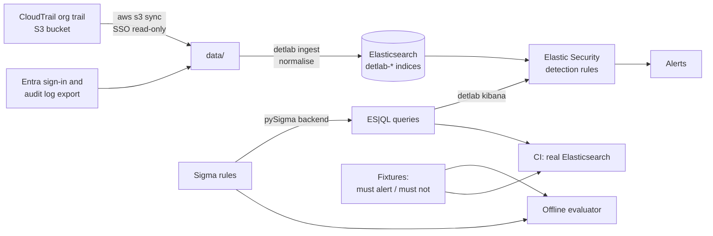

# Project 9: Cloud Detection Engineering

Detection rules for AWS CloudTrail and Microsoft Entra ID, written in Sigma, mapped to MITRE
ATT&CK, converted to Elasticsearch ES|QL and run as Elastic Security detection rules.

Each rule has sample events it must fire on and events it must ignore. Those cases run three
ways: offline in Python, against a real Elasticsearch in CI, and as a controlled trigger in
my own AWS and Entra lab (the one built in Project 8).


## Rules

| Rule | Severity | ATT&CK |
|---|---|---|
| CloudTrail stopped, deleted or modified | critical | T1685.002 |
| Root user console sign-in or password recovery | high | T1078.004 |
| Console sign-in without MFA (IAM user or root) | high | T1078.004 |
| Break-glass account sign-in | high | T1078.004 |
| Tier-0 Entra role assigned (Global Admin and similar) | high | T1098.003 |
| Five or more accounts disabled by one actor in 10 minutes | high | T1531 |
| IAM access key created | medium | T1098.001 |
| SCP or Identity Center permission set changed | medium | T1484, T1098.003 |
| Write activity outside ap-southeast-2 | medium | T1535 |
| Ten or more failed sign-ins for one user in 10 minutes | medium | T1110.001 |

The full matrix, with test results, is in [docs/coverage-matrix.md](docs/coverage-matrix.md).

## How it fits together



## What I found along the way

ES|QL doesn't behave the way the Sigma spec assumes, and some of the differences make a rule
fail silently. A comparison on an array field never matches, string matching is
case-sensitive, a filter on a missing field drops the event, and a field that isn't mapped
yet breaks the whole query. I fixed what could be fixed at ingest (flattening Entra role
properties, adding a lower-cased UPN), added a lint check for unmapped fields, and kept the
rest as tested "known gap" cases so nobody is surprised later. Details in
[docs/design-notes.md](docs/design-notes.md).

### From the lab tests (real logs, 2026-11-26 to 28)

- **Three false positives** that the fixtures missed, each tuned and turned into a fixture
  case: CloudTrail copying the organisation trail into member accounts (Critical tampering
  alert), and root console sign-ins logged by regional sign-in endpoints in us-east-2 and
  us-west-2 (region alert). See the tuning log in the design notes.
- **One blind spot:** with centralised root access on, a failed root sign-in to a member
  account isn't logged at all, but a root password recovery request is. The root rule now
  catches that too.
- **Late data:** logs pulled by hand arrived after a 10-minute look-back, so the rules now
  look back 60 minutes. A probe on the lab cluster showed that aggregating ES|QL rules repeat
  alerts across overlapping windows, so the two correlation rules keep 10 minutes.
- **A real break-glass finding:** the break-glass rule flagged an emergency access account
  still signed in on an everyday phone (follow-up: revoke its sessions).
- Every AWS test that a guardrail blocked (StopLogging, CreateAccessKey, out-of-region
  CreateTopic) still alerted: prevented and detected.
- The Entra portal's JSON export uses the Graph field names, confirmed with `check-export`.

Two smaller ones: the default Elastic rule schedule (5 minutes) is shorter than the 10-minute
correlation window, so those rules could never see a full window; and MITRE ATT&CK v20 moved
"Disable or Modify Cloud Logs" to T1685.002 under the new Defense Impairment tactic.

## Run it

```bash
python -m venv .venv
source .venv/bin/activate       # Windows: .\.venv\Scripts\Activate.ps1
pip install -e ".[dev]"

detlab test                     # every fixture case through the offline evaluator
detlab lint                     # metadata, fixtures, field mappings, redaction, generated files
sigma check rules               # Sigma syntax and ATT&CK tags
```

With an Elasticsearch to talk to (`ES_URL`, `ES_API_KEY`):

```bash
detlab live-validate            # same fixtures, real ES|QL, throwaway detlabtest-* indices
detlab check-export data/       # offline: do real logs have the fields the rules use?
detlab ingest data/             # load real CloudTrail / Entra logs
detlab kibana                   # build/kibana-rules.ndjson to import into Elastic Security
```

## Repo layout

| Path | What's there |
|---|---|
| `rules/` | Sigma rules (`aws/`, `entra/`) |
| `tests/fixtures/` | sample events per rule, all placeholders (no real IDs) |
| `pipelines/` | pySigma pipeline: which index each log source lives in |
| `elastic/` | index template and the generated ES|QL (`esql/`) |
| `src/detlab/` | normaliser, offline evaluator, converter, ingest, lint, CLI |
| `docs/` | SIEM setup, ingestion, lab testing guide, design notes, coverage matrix |
| `docs/playbooks/` | triage playbooks for the three highest-impact alerts |
| `validation/lab-tests.yml` | results of the controlled tests in the real lab |
| `evidence/` | redacted alert screenshots |

## Status

- [x] 10 rules with fixtures, offline evaluator, CI against real Elasticsearch
- [x] Triage playbooks: CloudTrail tampering, root sign-in, tier-0 role assignment
- [x] Elastic 9.5.7 running locally in WSL2 ([docs/siem-setup.md](docs/siem-setup.md))
- [x] Real CloudTrail (Dev and management accounts) and Entra logs ingested ([docs/ingestion.md](docs/ingestion.md))
- [x] **All 10 rules triggered in the lab and alerted**, with redacted screenshots
  ([validation/lab-tests.yml](validation/lab-tests.yml), [evidence/](evidence/),
  [docs/coverage-matrix.md](docs/coverage-matrix.md))

## Cost

US$0 so far. The SIEM runs locally; the only AWS cost is a few S3 GET requests for the
log sync.

## Related projects

Builds on Project 6 (cloud log analysis), Project 7 (PCAP threat analyser) and Project 8
(the AWS and Entra identity lab these rules watch).
